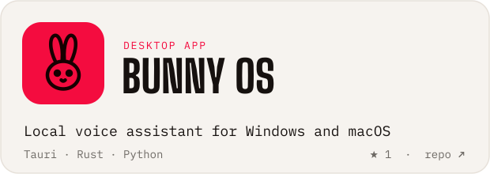
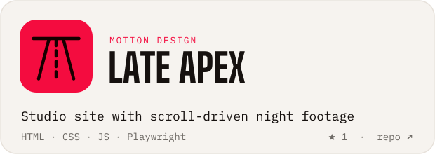
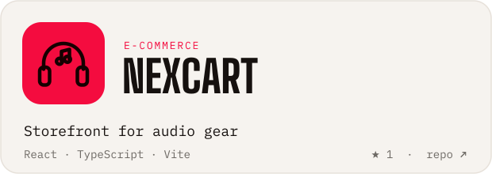
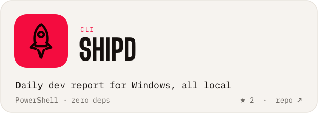
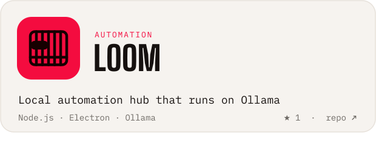

<!-- Images are drawn by scripts/build.py and refreshed daily by .github/workflows/refresh.yml. -->

<a href="https://harshh.pages.dev">
  <picture>
    <source media="(prefers-color-scheme: dark)" srcset="assets/bento-dark.svg">
    
  </picture>
</a>

<picture>
  <source media="(prefers-color-scheme: dark)" srcset="assets/activity-dark.svg">
  
</picture>

## Things I've built

<a href="https://github.com/harsh4k/Getcited"><picture><source media="(prefers-color-scheme: dark)" srcset="assets/project-getcited-dark.svg"></picture></a>
<a href="https://github.com/harsh4k/Bunny-OS"><picture><source media="(prefers-color-scheme: dark)" srcset="assets/project-bunny-os-dark.svg"></picture></a>
<a href="https://www.velsaro.in/"><picture><source media="(prefers-color-scheme: dark)" srcset="assets/project-velsaro-dark.svg"></picture></a>
<a href="https://github.com/harsh4k/apexfr"><picture><source media="(prefers-color-scheme: dark)" srcset="assets/project-late-apex-dark.svg"></picture></a>
<a href="https://github.com/harsh4k/rudo"><picture><source media="(prefers-color-scheme: dark)" srcset="assets/project-rudo-dark.svg"></picture></a>
<a href="https://github.com/harsh4k/nexcart"><picture><source media="(prefers-color-scheme: dark)" srcset="assets/project-nexcart-dark.svg"></picture></a>
<a href="https://github.com/harsh4k/shipd"><picture><source media="(prefers-color-scheme: dark)" srcset="assets/project-shipd-dark.svg"></picture></a>
<a href="https://github.com/harsh4k/loom"><picture><source media="(prefers-color-scheme: dark)" srcset="assets/project-loom-dark.svg"></picture></a>

## Say hi

Building something interesting, or want to talk web, WebGL or local AI? I'm happy to chat.

<b><a href="https://harshh.pages.dev">Portfolio</a></b> · <b><a href="https://www.linkedin.com/in/harshit-chauhan-17a898364/">LinkedIn</a></b> · <b><a href="mailto:harshitsinhchauhan250@gmail.com">Email</a></b>

<picture>
  <source media="(prefers-color-scheme: dark)" srcset="assets/footer-dark.svg">
  
</picture>
